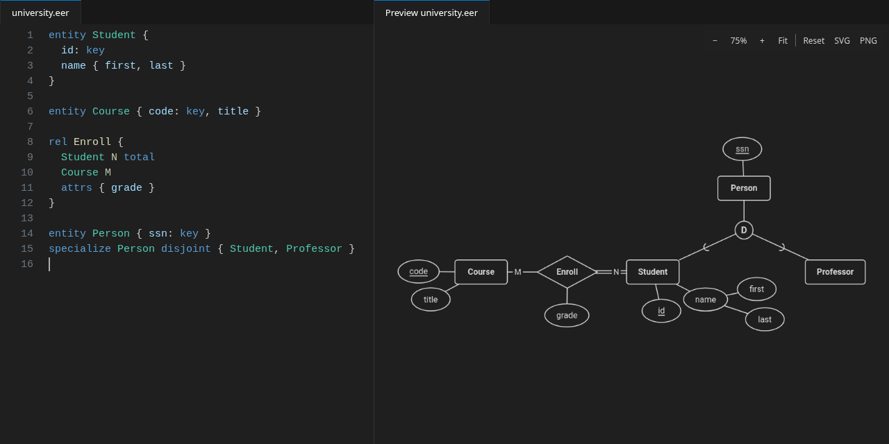
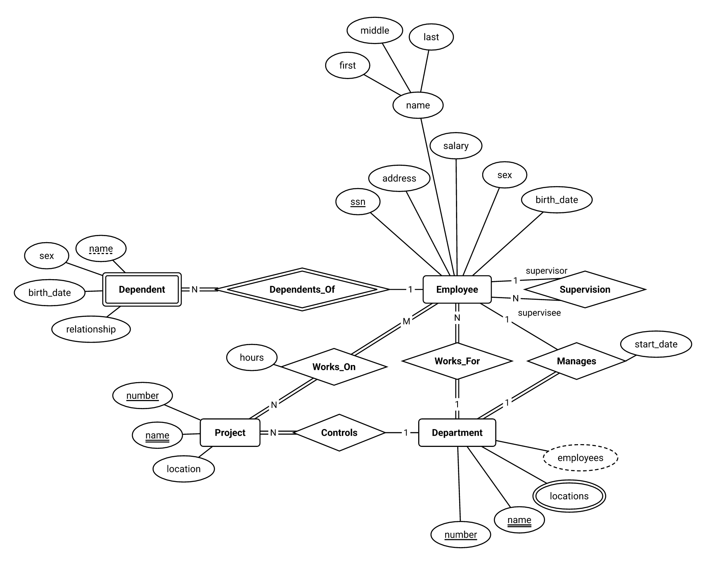
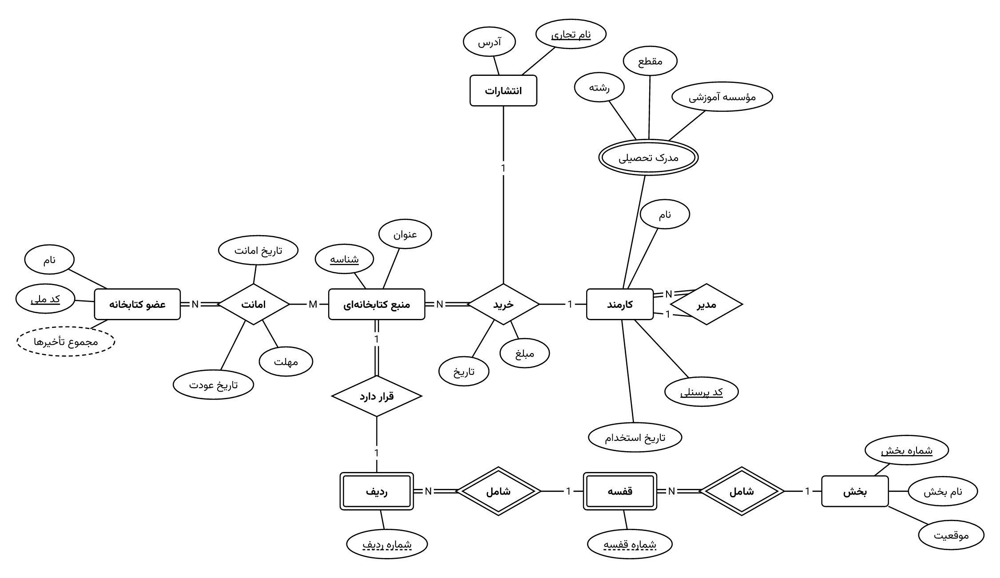
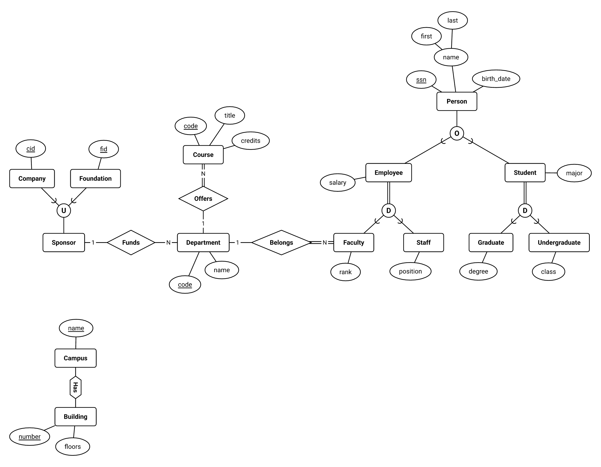
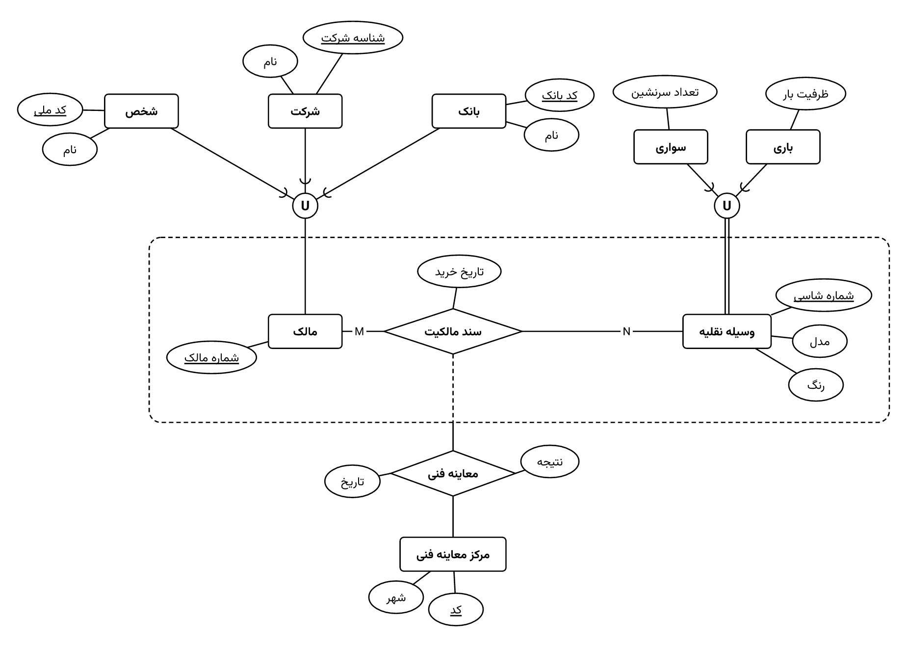

# Draw EER

Write ER and EER diagrams as text and see them drawn as you type, in the classic Chen notation
of database courses and textbooks (Elmasri & Navathe). A VS Code extension, with Persian
(right-to-left) names fully supported.



## Gallery

<table>
<tr>
<td width="50%"></td>
<td width="50%"></td>
</tr>
<tr>
<td align="center">ER, English: <a href="https://github.com/AmirMOHNasiri/Draw-EER/blob/main/examples/company.eer"><code>company.eer</code></a></td>
<td align="center">ER, Persian: <a href="https://github.com/AmirMOHNasiri/Draw-EER/blob/main/examples/library.eer"><code>library.eer</code></a></td>
</tr>
<tr>
<td></td>
<td></td>
</tr>
<tr>
<td align="center">EER, English: <a href="https://github.com/AmirMOHNasiri/Draw-EER/blob/main/examples/university.eer"><code>university.eer</code></a></td>
<td align="center">EER, Persian: <a href="https://github.com/AmirMOHNasiri/Draw-EER/blob/main/examples/vehicles.eer"><code>vehicles.eer</code></a></td>
</tr>
</table>

Every picture above is the automatic layout, untouched. The texts are in [`examples/`](examples).

## Install

- **VS Code:** open the Extensions view (`Ctrl+Shift+X`), search for **Draw EER**, and install.
  Or press `Ctrl+P` and run `ext install amirmohnasiri.draw-eer`.
- **VSCodium and other editors that use Open VSX:** the same, from
  [open-vsx.org](https://open-vsx.org).
- **From a `.vsix` file** (from the
  [releases page](https://github.com/AmirMOHNasiri/Draw-EER/releases)): in the Extensions view,
  open the `···` menu and choose **Install from VSIX…**, or run
  `code --install-extension draw-eer-0.1.0.vsix`.

Requires VS Code 1.90 or newer. Works the same on Windows, macOS and Linux, and needs nothing
else installed: the font and everything else ship with the extension.

## Quick start

1. Create a file whose name ends in `.eer`, for example `university.eer`.
2. Type a diagram:

   ```
   entity Student {
     id: key
     name { first, last }
   }

   entity Course { code: key, title }

   rel Enroll {
     Student N total
     Course M
     attrs { grade }
   }
   ```

3. Press `Ctrl+K V` (`Cmd+K V` on macOS), or click the preview button at the top right of the
   editor. The diagram appears beside the text and is redrawn as you type.
4. Drag shapes in the preview if you want them somewhere else, and export the picture with the
   **SVG** or **PNG** button.

## The language at a glance

```
entity Employee {
  ssn: key                         // primary key: underlined
  passport: key2                   // secondary key: double underline
  name { first, last }             // composite attribute
  phones: multi                    // multi-valued: double ellipse
  age: derived                     // derived: dashed ellipse
}

weak entity Dependent { name: partial }        // weak entity, partial key

identifying rel Has { Employee 1, Dependent N total }   // double diamond, double line

rel Works_On {
  Employee (1,N) total             // (min,max), or 1, N, M
  Project (0,M)
  attrs { hours }
}

rel Supervision { Employee 1 as supervisor, Employee N as supervisee }   // roles

specialize Employee disjoint total { Secretary, Engineer }   // circle with D
category Owner { Person, Bank }                               // circle with U
partof Car { Engine, Wheel }                                  // "Has" hexagons
aggregate Guidance { rel Guides { Professor, Student } }      // dashed box
```

Names can be Persian, or quoted when they contain spaces: `"عضو خانواده"`. Only syntax is
checked: if the text parses, it is drawn, whatever the design. The full reference, with the
grammar, is in [docs/language.md](docs/language.md).

## Features

**Live preview.** Open it with `Ctrl+K V` (beside the editor) or `Ctrl+Shift+V` (in place), or
from the Explorer's context menu. It redraws as you type, follows your color theme, and comes back
when VS Code restarts. Scroll to zoom around the pointer, drag the background to pan,
double-click or press `F` to fit, `0` for actual size.

**Dragging and pinning.** Drag a shape or an attribute to move it; a shape's attributes come
along. A shape snaps into line with the shapes it is joined to, so its lines become straight again
(hold `Alt` to place it freely); `Escape` cancels. After the first drag, nothing moves unless you
move it: new elements you type are placed around the existing ones. `Ctrl+Z` and `Ctrl+Shift+Z`
undo and redo moves, and **Reset** in the preview's toolbar goes back to the automatic layout.

**Export.** **SVG** and **PNG** in the preview's toolbar, in the Explorer's context menu, or in the
Command Palette (**Draw EER: Export as SVG…** / **Export as PNG…**), with or without a preview
open. Exports are black on white, whatever the theme. The SVG embeds the font, cut down to the
characters the diagram uses (a few KB), so Persian text looks right on any computer; the PNG is
sharp enough for slides and print.

**Editing help.** Syntax highlighting, bracket matching and comment toggling; completion for
keywords, attribute flags, entity names, cardinalities and participation; and syntax errors as
squiggles with "did you mean" hints (`en` → `entity`). Most errors have a Quick Fix (the light
bulb, or `Ctrl+.`): a misspelled keyword, a missing `:`, `,` or `}`, a name that needs quotes,
a Persian comma `،` where `,` is meant.

**Persian.** Persian and English names mix freely. Text is shaped with the bundled
[Vazirmatn](https://github.com/rastikerdar/vazirmatn) font, so letters join correctly, and rows of
attributes and of subtypes read right to left when their names are Persian.

### The layout file

Moves are saved in `<name>.eer.layout.json` next to `<name>.eer`, one element per line and sorted,
so it diffs well in version control; commit it with the diagram.

```json
{
  "version": 1,
  "nodes": {
    "entity:Student": { "x": 412, "y": 230 }
  },
  "attributes": {
    "attr:entity:Student/name": { "x": -150, "y": -20 }
  }
}
```

- Without a layout file, the automatic layout places everything. The first drag saves the whole
  layout as shown, so from then on **nothing moves unless you move it**: editing the text never
  moves an element that is in the file.
- A shape (`nodes`) stores its center. An attribute stores where it sits relative to its owner
  (its shape, or the composite attribute it is part of), so it moves along with the owner.
- Elements added to the text are placed around the pinned ones, which stay fixed: a new shape
  goes to the best free spot next to the shapes it is joined to (short, straight lines that cross
  nothing), further out if nothing nearby is free; new attributes go in the free angles around
  their owner; a group of new shapes joined to nothing pinned goes where it grows the drawing
  least. Nothing new ever overlaps anything, and a dragged shape cannot be dropped onto another.
  New elements are then saved to the file too.
- Elements deleted from the text are dropped from the file. This waits while the text has syntax
  errors, so an element hidden for a moment by a half-typed edit keeps its place.
- Keys are built from names, so a renamed element counts as a new one.
- **Reset** (in the preview's toolbar) deletes the file and goes back to the automatic layout;
  `Ctrl+Z` brings the file back. Changes to the file made outside the preview (by hand, or a
  `git checkout`) show up at once. A file that cannot be read gives a warning, and the automatic
  layout is used.

## Settings

| Setting                       | Default | Description                                                       |
| ----------------------------- | ------- | ----------------------------------------------------------------- |
| `drawEer.preview.updateDelay` | `300`   | Milliseconds to wait after typing stops before redrawing.         |
| `drawEer.export.pngScale`     | `3`     | Size of exported PNG images, as a multiple of the diagram's size. |

## How the layout works

The layout is custom, tuned on textbook figures (the library diagram in
`packages/core/test/fixtures/library.eer` is the quality bar). It runs in four stages.

**1. Grid placement with costs** (`grid.ts`). Entities and relationships go into the cells of an
invisible grid, one at a time, starting from the best-connected entity. Every free cell near the
shapes already placed gets a cost, and the cheapest wins:

- horizontal and vertical lines are free, diagonals cost a little, other angles more, and longer
  lines cost per extra cell (vertical ones slightly more, so chains prefer to run left to right);
- a line through another shape, or two lines crossing, cost a lot;
- the lines leaving a shape should spread out, and at a relationship they should be opposite each
  other, so entity–relationship–entity is one straight line and a ternary relationship forms a T;
- a shape with attributes needs an open side for them;
- the drawing pays for its area and for being outside a landscape ratio (about 3:2 to 2:1),
  because diagrams end up in slides and reports. This is checked while the drawing grows, so a
  long chain folds as it is placed (a chain inside a cycle cannot be folded afterwards).

This runs from a few starting shapes and the cheapest result is kept.

**2. Folding.** The greedy result is then improved by rotating whole branches (the part of the
diagram behind a line whose removal splits it in two) by 90°, 180° or 270° around the shape they
hang from, and by turning the whole drawing. A rotation is kept if it lowers the total cost.

**3. Attribute fans** (`attributes.ts`). Each shape's attributes spread in an arc in the free
angles between its lines, centered on the nearest straight direction (up, down, left, right).
The fan tries, in order:

1. sides that face no relationship partner (35° clear of each line) and no unrelated neighbour,
   staying on its own half of every straight line, so two neighbours' fans never compete for the
   space between them and that line keeps its target length;
2. the same without the halfway limit;
3. any free side, as far out as needed.

Within a side, simple attributes may sit on an inner ring and composite ones on an outer ring
between them, which keeps a shape with many attributes compact. If a side cannot hold all its
attributes, the smallest move to the next side. Rows read left to right, or right to left when
the names are Persian or Arabic. A composite key's parts sit in one row with one line under them.
On a recursive relationship, role names sit outside the loop, next to their own line, and
attributes keep clear of them; nothing goes inside a loop. A neighbour close by blocks the whole
angle it covers; one further away than attributes reach blocks only the space it takes up, so
attributes can still sit in front of it. A composite key's row never lines up with the line to
its far part: if it would, it moves to the nearest spot where every part's line runs clear.

**4. Compaction** (`layout.ts`). Grid cells become pixel positions. Shapes joined by a straight
line share a center line, so the line stays straight; nothing else is tied together. Each axis is
then solved in turn: shapes keep their grid order and a minimum gap from everything that faces
them, and every entity–relationship line is pulled toward one target length (just enough for its
cardinality label and a margin), which gives the even look of a hand-drawn figure. Both axis
orders are tried and the one with shorter lines wins. Slanted lines keep most of their grid
slope, so they do not flatten into other shapes. Attributes are then placed again for the real
angles and compaction repeats (three rounds). Compaction only keeps shapes apart along the axes, so
a slanted line can still pass close to a shape beside it; that shape is then kept further from
the line's end it faces, until the line clears it by 24 px, and compaction runs again (up to
three times). Finally, any shape whose attributes ended up under a line, or within 24 px of a
relationship or tree line, gets them placed once more with everything else fixed.

**Hierarchies** (`tree.ts`). Specializations, categories and part-of are not placed shape by
shape. Each connected hierarchy is laid out as a tidy top-down tree (Reingold–Tilford style):
the supertype on top, the D/O circle straight below it, the subtypes in one evenly spaced row,
centered under the circle; subtrees keep clear of each other level by level. The superclasses
of a category (or the supertypes of a shared subtype) form a row above it, and each part-of
hexagon sits halfway along its line. Children follow the text, right to left when most of
their names are Persian. The tree then moves as one rigid block: the grid places it whole
(never turned) and keeps its inside free, and compaction moves its shapes together. A shape
in a tree keeps its attributes beside or below it, off the tree's lines. Every line down a tree
slopes at least 30°, so a wide row of children gets a taller gap above it and the tree still
reads top-down; a shared subtype's line from its second supertype, which may cross the whole
tree, needs only 20°. A line down the tree that passes another shape of the tree closer than
24 px lowers the row it goes down to until it clears it. A relationship
between two trees prefers both entities in its own row, so its line is straight. A subtype
whose supertypes are not all in one tree (one is inside an aggregate, or they are in different
trees) is in none of them: it goes on its own, below its supertypes and centered between them,
with the supertypes in one row, as far as the rest of the diagram allows.

**Aggregates.** An aggregate is laid out first, on its own: the relationship inside, its
participants around it (nothing below it, where the line to the outer relationship leaves),
and all their attributes. Participants that also connect to the outside keep their outer half
free of attributes (lines from outside may arrive anywhere in it), and every arrangement of the participants around the diamond is tried as
a variant, so the grid can turn each one to face its outside lines. The dashed box encloses
exactly that block with even padding; compaction treats the box as an obstacle, so nothing
else can come near it, and the outer relationship goes straight below the diamond.

An aggregate whose participants are also in a hierarchy (a subtype inside the box) is drawn
together with that tree, as one rigid block (`compound.ts`): the participants stay on their tree
rows, and they move to one side of the tree so the box takes that side without enclosing
anything else. The tree widens and lowers until the participants are as far apart as in the
aggregate's own layout, and the aggregate stretches to match. A row of the tree stays
symmetric unless that pushes a child the aggregate does not pin more than 1.5 sibling spacings
away; then the parent stays over its free children and only the pinned child's line gets long.
An aggregate that spans two trees, one participant in each, hangs each tree from its participant.

**Speed.** Layout runs again whenever the text changes, so it must be fast. Real diagrams (up to
about 50 shapes and attributes) take 1–250 ms, a 300-element synthetic diagram about 3 s (see
`npm run bench`). Diagrams with more than 150 shapes and attributes get a cheaper search (one
starting shape, fewer rounds, no repair of lines that cut corners). This depends only on the diagram, never on the clock, so the same
text always gives the same picture.

**With a layout file** (`incremental.ts`), the steps above run only until the first drag. After
that, pinned elements are fixed obstacles and only new elements are placed: a new shape is tried
at line-length distances in eight directions around each placed shape it is joined to, ring by
ring further out, and the cheapest spot where it and its attributes overlap nothing wins (short,
straight lines that cross no other line and run through no shape). New attributes of a pinned
owner take the nearest free spot around it. A group of new shapes joined to nothing pinned is laid
out by steps 1–4 on its own and put where the drawing grows least. A whole layout first pinned
and then edited this way takes a few milliseconds.

ELK's layered algorithm was tried first and dropped: it forces every line into one main
direction, so it cannot draw a T or put a participant above a relationship. When the automatic
result is not what you want, drag shapes in the preview; from then on they stay where you put
them.

## Development

Draw EER is written in TypeScript: `packages/core` is the parser, layout and renderer (no VS Code
or DOM), and `packages/vscode` is the extension. With Node.js 22.12 or newer:

```sh
npm install
npm test
npm run build
```

Then open the repository in VS Code and press `F5` to try the extension. See
[docs/development.md](docs/development.md) for how it all works, the tests, and how to record the
demo, package and release.

## License

[MIT](LICENSE). The bundled Vazirmatn font is under the
[SIL Open Font License](https://github.com/rastikerdar/vazirmatn/blob/master/OFL.txt).
